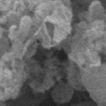
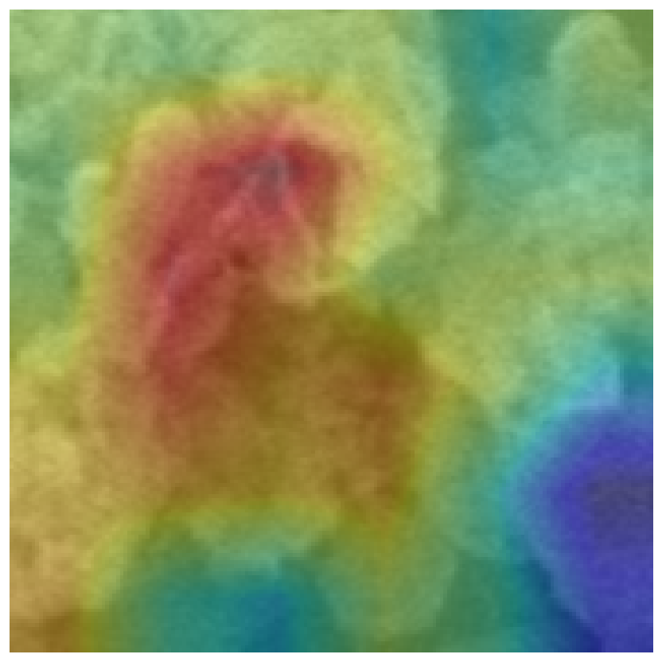

# SEM-based Classification of Microbial Colonisation on MFC Electrodes

Deep transfer learning and explainable AI (Grad-CAM) for classifying microbial colonisation on microbial fuel cell (MFC) electrodes from scanning electron microscopy (SEM) images.

<p align="center">
  
  
</p>
<p align="center"><em>Example SEM patch (left) and its Grad-CAM explanation (right).</em></p>

## Overview

- Five-class colonisation scheme for SEM image patches
- Benchmarking of pretrained CNN architectures with cross-validation and fixed-split validation
- Comparison with traditional image-analysis baselines
- Grad-CAM explanations of model predictions

## Getting started

```bash
git clone https://github.com/Nasim-Amani/sem-mfc-biofilm-classification.git
cd sem-mfc-biofilm-classification
pip install -r requirements.txt

# Example: train EfficientNetB0 with 4-fold cross-validation
python -m src.train_cv --model EfficientNetB0 --data_dir data
```
